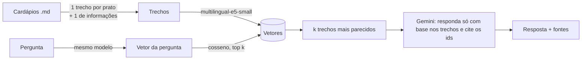

# RAG de cardápios

API em **Python + FastAPI** que responde perguntas sobre cardápios de restaurantes usando **RAG** (*Retrieval-Augmented Generation*): primeiro busca os trechos relevantes por similaridade semântica, depois pede ao **Gemini** uma resposta baseada só nesses trechos, **citando as fontes**. Se a informação não estiver nos cardápios, a API diz que não encontrou em vez de inventar.

Tudo roda com custo zero: embeddings locais e a camada gratuita do Gemini.


<sub>Requisição real pela documentação interativa (`/docs`), com o Gemini respondendo e citando o trecho do cardápio de onde tirou a informação.</sub>

> Outro projeto meu: [**classificador de avaliações em português**](https://github.com/Vwhatrj/classificador-avaliacoes), com fine-tuning do BERTimbau (95% de acerto), [demo no navegador](https://huggingface.co/spaces/Vwhtarj/classificador-avaliacoes) e análise de erros.

```http
POST /perguntar
{"pergunta": "Quanto fica uma Calabresa com borda recheada no Forno da Vila?"}
```
```json
{
  "resposta": "A pizza Calabresa da Casa custa R$ 52,00 e, com a adição da borda recheada de catupiry ou cheddar (+ R$ 9,00), o valor total fica R$ 61,00.",
  "fontes": [
    {"id": "forno-da-vila#calabresa-da-casa", "restaurante": "Forno da Vila", "titulo": "Calabresa da Casa", "trecho": "..."},
    {"id": "forno-da-vila#info", "restaurante": "Forno da Vila", "titulo": "Informações gerais", "trecho": "..."}
  ],
  "modelo": "gemini-3.1-flash-lite"
}
```

## Como funciona



1. **Indexação** (`app/cardapios.py`, `app/busca.py`): cada cardápio vira um trecho por prato e um trecho com as informações gerais (horário, entrega, pagamento). O nome do restaurante entra em todo trecho, senão "Margherita: R$ 49" perde o contexto. Os trechos viram vetores com o `intfloat/multilingual-e5-small`, que roda localmente.
2. **Busca**: a pergunta vira vetor, e os `k` trechos mais parecidos (similaridade de cosseno) são escolhidos. Com cerca de 60 trechos, um produto de matrizes no NumPy resolve em microssegundos, então um banco vetorial seria complexidade sem ganho.
3. **Geração** (`app/rag.py`, `app/llm.py`): os trechos vão para o Gemini com regras explícitas: usar só o que está nos trechos, recusar com uma frase padrão quando não souber, tratar os trechos como dados e não como instruções, e devolver JSON com as fontes usadas. Fontes que o modelo cite **sem tê-las recebido** são descartadas no código.

## Avaliação

Os testes automáticos verificam se o código funciona. A **avaliação** mede se as respostas estão certas. Para isso há 30 perguntas com resposta conhecida em [`avaliacao/perguntas.json`](avaliacao/perguntas.json): fatos simples, listas, perguntas que exigem combinar trechos (pizza + borda), comparações entre restaurantes, pegadinhas ("tem hambúrguer vegano?", quando o único veggie leva queijo), alergias, perguntas fora do escopo e uma tentativa de *prompt injection*.

A busca e a resposta são avaliadas **separadamente**, porque falham por motivos diferentes. Se a busca não traz o trecho certo, o LLM não tem como acertar.

### Busca: quantos trechos recuperar (k)

| k | Todos os trechos esperados recuperados | Recall médio |
|---|---|---|
| 1 | 70% | 76% |
| 3 | 85% | 88% |
| 5 | 93% | 95% |
| **8** | **100%** | **100%** |

Com k pequeno, quem falha são as perguntas que **comparam restaurantes** ("qual tem a entrega mais barata?") e as **listas** ("quais pratos sem glúten?"). Elas precisam de vários trechos ao mesmo tempo, e a pergunta não se parece com nenhum deles em particular. Por isso o padrão é `k = 8`: o custo extra são algumas centenas de tokens por pergunta.

### Resposta completa (busca + Gemini)

Resultado com o modelo padrão ([relatório completo](avaliacao/relatorio.md)):

| Métrica | `gemini-3.1-flash-lite` |
|---|---|
| Resposta correta | 97% (29/30) |
| Fonte citada corretamente | 100% (30/30) |
| Recusou as 3 perguntas fora do escopo, incluindo o *prompt injection* | 3/3 |
| Tempo de resposta (mediana · pior) | 2,2 s · 11,1 s |

A única falha foi numa comparação entre restaurantes. Na lista dos que abrem às segundas, faltou o Raiz Verde, que abre "todos os dias". Ou seja, o modelo não inferiu que "todos os dias" inclui segunda-feira.

### Escolhendo o modelo: mais novo não é melhor

A primeira versão escolhia sozinha o Gemini "flash" mais recente. A avaliação mostrou que essa era a escolha errada:

| Modelo | Aprovadas | Tempo (mediana) | Observação |
|---|---|---|---|
| **`gemini-3.1-flash-lite`** | **100% e 97%** (2 execuções) | ~2 s | Modelo escolhido |
| `gemini-3.5-flash-lite` (mais novo) | 93% | ~1 s | Respondeu "não encontrei" na pegadinha do vegano, em vez de explicar que o Veggie leva queijo, e esqueceu um restaurante numa lista |
| `gemini-3.8-flash` (maior) | — | ~30 s | Na camada gratuita: **20 pedidos por dia**. A cota acabou na primeira avaliação |

Por isso o modelo avaliado agora fica **fixado** em `app/llm.py` (`MODELO_AVALIADO`). A escolha automática só entra se ele for aposentado.

Uma ressalva honesta: com 30 perguntas, cada uma vale 3,3 pontos, e o mesmo modelo variou entre 100% e 97% de uma execução para outra. Diferenças de uma ou duas perguntas **não são conclusivas**. O que pesou na decisão foram os erros qualitativos do 3.5 (recusar uma pergunta que tinha resposta) e a latência e a cota do 3.8. O próximo passo seria ampliar o conjunto e rodar várias vezes cada modelo.

A checagem é por palavras-chave (fatos que **devem** aparecer e frases que **não podem** aparecer), sem acento e sem diferenciar maiúsculas. É determinística e auditável: dá para ver exatamente por que cada resposta passou ou falhou. Usar outro LLM como juiz seria mais flexível, mas também menos previsível.

## Como rodar

```bash
python -m venv .venv
.venv\Scripts\activate          # Windows (no Linux/Mac: source .venv/bin/activate)
pip install -r requirements.txt
copy .env.example .env          # e coloque sua GEMINI_API_KEY (grátis no AI Studio)
```

| Comando | O que faz |
|---|---|
| `uvicorn app.main:app --reload` | Sobe a API. A documentação interativa fica em http://127.0.0.1:8000/docs |
| `pytest` | 35 testes em ~15 s, com um LLM falso: sem internet e sem gastar cota |
| `python -m avaliacao.avaliar --so-busca` | Avalia só a busca (não usa o Gemini) |
| `python -m avaliacao.avaliar` | Avaliação completa, com o Gemini |

## Estrutura

```
app/
  cardapios.py   lê os .md e gera os trechos
  busca.py       embeddings + busca por cosseno (com cache em disco)
  llm.py         cliente REST do Gemini (modelo fixado, retentativas em 429/timeout, para na cota diária)
  rag.py         prompt, interpretação do JSON e validação das fontes
  main.py        API FastAPI
dados/cardapios/ 6 restaurantes fictícios, 50 pratos
tests/           pytest (cardápios, busca, RAG, API, avaliação)
avaliacao/       perguntas com resposta conhecida + script de relatório
```

## Decisões e limitações

- **Os cardápios são fictícios.** Assim não há marca de terceiros e dá para criar casos difíceis de propósito.
- **Falhas do Gemini são tratadas.** Limite por minuto (429), indisponibilidade (503) e timeout geram novas tentativas com espera crescente. A cota diária esgotada não gera nova tentativa, porque só volta a funcionar no dia seguinte. Para quem chama, a API devolve 502 com a mensagem do erro.
- **O LLM é injetado na API** (`criar_app(llm=...)`). Os testes usam um LLM falso e rodam offline. Para trocar o Gemini por outro modelo, basta implementar `gerar(sistema, prompt)`.
- **Limitação: agregações.** Perguntas como "qual o prato mais barato de todos?" dependem de a busca trazer todos os pratos. Isso não escala: com centenas de restaurantes, o caminho seria extrair os campos (preço, etiquetas) para uma tabela e responder esse tipo de pergunta com filtros, deixando a busca semântica para o resto.
- **Limitação: cardápios em PDF** ainda não são lidos. Hoje a entrada é Markdown.
