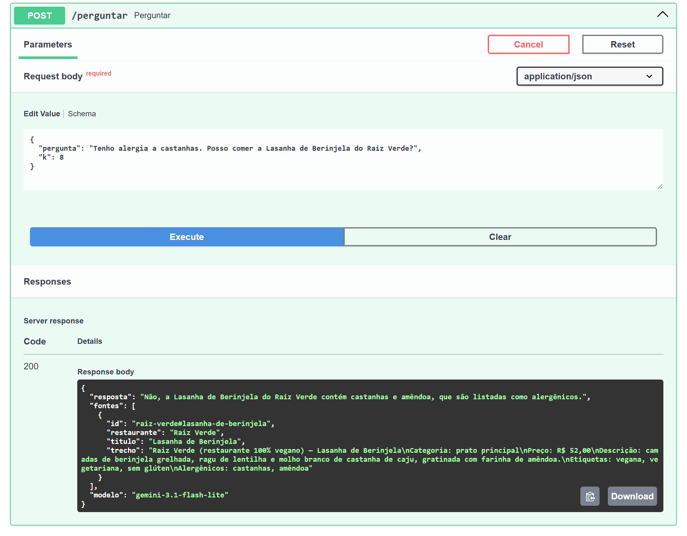
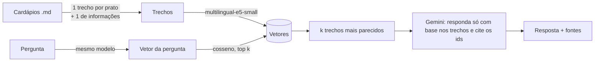

# RAG de cardápios

API em **Python + FastAPI** que responde perguntas sobre cardápios de restaurantes usando **RAG** (*Retrieval-Augmented Generation*): primeiro busca os trechos relevantes por similaridade semântica, depois pede ao **Gemini** uma resposta baseada só nesses trechos, **citando as fontes**. Se a informação não estiver nos cardápios, a API diz que não encontrou em vez de inventar.

Há também um **agente com ferramentas** (`POST /agente`): o próprio Gemini decide quando filtrar a tabela de pratos, buscar trechos ou consultar horários e entrega. Ele resolve perguntas como "qual a sobremesa mais barata?" ou "quantos itens veganos existem?", em que o RAG simples falha: [veja a comparação](#agente-com-ferramentas).

Tudo roda com custo zero: embeddings locais e a camada gratuita do Gemini.



<sub>Requisição real pela documentação interativa (`/docs`), com o Gemini respondendo e citando o trecho do cardápio de onde tirou a informação.</sub>

> Outro projeto meu: [**classificador de avaliações em português**](https://github.com/Vwhatrj/classificador-avaliacoes), com fine-tuning do BERTimbau (95% de acerto), [demo no navegador](https://huggingface.co/spaces/Vwhtarj/classificador-avaliacoes) e análise de erros.

```http
POST /perguntar
{"pergunta": "Quanto fica uma Calabresa com borda recheada no Forno da Vila?"}
```
```json
{
  "resposta": "A pizza Calabresa da Casa custa R$ 52,00 e, com a adição da borda recheada de catupiry ou cheddar (+ R$ 9,00), o valor total fica R$ 61,00.",
  "fontes": [
    {"id": "forno-da-vila#calabresa-da-casa", "restaurante": "Forno da Vila", "titulo": "Calabresa da Casa", "trecho": "..."},
    {"id": "forno-da-vila#info", "restaurante": "Forno da Vila", "titulo": "Informações gerais", "trecho": "..."}
  ],
  "modelo": "gemini-3.1-flash-lite"
}
```

## Como funciona



1. **Indexação** (`app/cardapios.py`, `app/busca.py`): cada cardápio vira um trecho por prato e um trecho com as informações gerais (horário, entrega, pagamento). O nome do restaurante entra em todo trecho, senão "Margherita: R$ 49" perde o contexto. Os trechos viram vetores com o `intfloat/multilingual-e5-small`, que roda localmente.
2. **Busca**: a pergunta vira vetor, e os `k` trechos mais parecidos (similaridade de cosseno) são escolhidos. Com cerca de 60 trechos, um produto de matrizes no NumPy resolve em microssegundos, então um banco vetorial seria complexidade sem ganho.
3. **Geração** (`app/rag.py`, `app/llm.py`): os trechos vão para o Gemini com regras explícitas: usar só o que está nos trechos, recusar com uma frase padrão quando não souber, tratar os trechos como dados e não como instruções, e devolver JSON com as fontes usadas. Fontes que o modelo cite **sem tê-las recebido** são descartadas no código.

## Avaliação

Os testes automáticos verificam se o código funciona. A **avaliação** mede se as respostas estão certas. Para isso há 30 perguntas com resposta conhecida em [`avaliacao/perguntas.json`](avaliacao/perguntas.json): fatos simples, listas, perguntas que exigem combinar trechos (pizza + borda), comparações entre restaurantes, pegadinhas ("tem hambúrguer vegano?", quando o único veggie leva queijo), alergias, perguntas fora do escopo e uma tentativa de *prompt injection*.

A busca e a resposta são avaliadas **separadamente**, porque falham por motivos diferentes. Se a busca não traz o trecho certo, o LLM não tem como acertar.

### Busca: quantos trechos recuperar (k)

| k | Todos os trechos esperados recuperados | Recall médio |
|---|---|---|
| 1 | 70% | 76% |
| 3 | 85% | 88% |
| 5 | 93% | 95% |
| **8** | **100%** | **100%** |

Com k pequeno, quem falha são as perguntas que **comparam restaurantes** ("qual tem a entrega mais barata?") e as **listas** ("quais pratos sem glúten?"). Elas precisam de vários trechos ao mesmo tempo, e a pergunta não se parece com nenhum deles em particular. Por isso o padrão é `k = 8`: o custo extra são algumas centenas de tokens por pergunta.

### Resposta completa (busca + Gemini)

Resultado com o modelo padrão ([relatório completo](avaliacao/relatorio.md)):

| Métrica | `gemini-3.1-flash-lite` |
|---|---|
| Aprovadas (resposta + fonte), em 3 execuções | 100%, 97% e 100% (30, 29 e 30 de 30) |
| Fonte citada corretamente | 100% nas 3 execuções |
| Recusou as 3 perguntas fora do escopo, incluindo o *prompt injection* | 3/3 |
| Chamadas ao LLM · tokens por pergunta | 1 · ~1.180 |

Na execução com 97%, a falha foi numa comparação entre restaurantes. Na lista dos que abrem às segundas, faltou o Raiz Verde, que abre "todos os dias". Ou seja, o modelo nem sempre infere que "todos os dias" inclui segunda-feira. Isso mostra que a mesma pergunta pode passar numa execução e falhar em outra.

### Escolhendo o modelo: mais novo não é melhor

A primeira versão escolhia sozinha o Gemini "flash" mais recente. A avaliação mostrou que essa era a escolha errada:

| Modelo | Aprovadas | Tempo (mediana) | Observação |
|---|---|---|---|
| **`gemini-3.1-flash-lite`** | **100%, 97% e 100%** (3 execuções) | ~2 s | Modelo escolhido |
| `gemini-3.5-flash-lite` (mais novo) | 93% | ~1 s | Respondeu "não encontrei" na pegadinha do vegano, em vez de explicar que o Veggie leva queijo, e esqueceu um restaurante numa lista |
| `gemini-3.8-flash` (maior) | — | ~30 s | Na camada gratuita: **20 pedidos por dia**. A cota acabou na primeira avaliação |

Por isso o modelo avaliado agora fica **fixado** em `app/llm.py` (`MODELO_AVALIADO`). A escolha automática só entra se ele for aposentado.

Uma ressalva honesta: com 30 perguntas, cada uma vale 3,3 pontos, e o mesmo modelo variou entre 100% e 97% de uma execução para outra. Diferenças de uma ou duas perguntas **não são conclusivas**. O que pesou na decisão foram os erros qualitativos do 3.5 (recusar uma pergunta que tinha resposta) e a latência e a cota do 3.8. O próximo passo seria ampliar o conjunto e rodar várias vezes cada modelo.

A checagem é por palavras-chave (fatos que **devem** aparecer e frases que **não podem** aparecer), sem acento e sem diferenciar maiúsculas. É determinística e auditável: dá para ver exatamente por que cada resposta passou ou falhou. Usar outro LLM como juiz seria mais flexível, mas também menos previsível.

## Agente com ferramentas

O RAG simples busca **uma vez**, antes do modelo, e o modelo só vê os 8 trechos mais parecidos com a pergunta. Isso falha em perguntas de **agregação**, como "o mais barato", "todos os que..." e "quantos". Nelas a resposta depende de olhar *todos* os pratos, e a pergunta não se parece com nenhum deles em particular.

No `POST /agente`, o Gemini recebe três ferramentas e decide sozinho quais chamar, quantas vezes e em que ordem (`app/agente.py`, `app/ferramentas.py`):

| Ferramenta | O que faz |
|---|---|
| `filtrar_pratos(preco_max, etiquetas, sem_alergenicos, categoria, restaurante, ordenar_por, …)` | Filtro **exato** sobre a tabela completa de pratos, lida dos mesmos `.md` (`app/catalogo.py`) |
| `buscar_cardapio(consulta, k)` | A busca semântica do RAG simples, agora como uma ferramenta entre outras |
| `info_restaurantes(restaurante)` | Horários, entrega, taxa e formas de pagamento |

O loop é: o modelo pede uma ferramenta, o código executa e devolve o resultado, e isso se repete até o modelo responder. O limite é de 6 passos. A resposta traz os **passos** que o agente deu, e as fontes citadas são validadas contra o que as ferramentas realmente devolveram:

```json
{
  "resposta": "A sobremesa mais barata é o Pudim de Leite, da Cantina Dona Lurdes, por R$ 10,00.",
  "fontes": [{"id": "cantina-dona-lurdes#pudim-de-leite", "...": "..."}],
  "passos": [{"ferramenta": "filtrar_pratos", "argumentos": {"categoria": "sobremesa", "ordenar_por": "preco", "limite": 1}, "resultados": 1}]
}
```

### RAG simples × agente

Os dois foram avaliados com o mesmo modelo nas 30 perguntas originais e em 11 perguntas de agregação. O gabarito dessas 11 é **calculado a partir dos próprios dados** ([`avaliacao/gerar_agregacao.py`](avaliacao/gerar_agregacao.py)), não escrito à mão.

| | RAG simples | **Agente** |
|---|---|---|
| 30 perguntas principais | 97–100% (29 ou 30 de 30, conforme a execução) | **97% (29 de 30)**: empatado, não piorou |
| 11 perguntas de agregação | 27% (3 de 11) | **91% (10 de 11)** |
| Chamadas ao LLM por pergunta | 1 | 2,0 em média (máximo 3) |
| Tokens por pergunta (entrada + saída) | ~1.120 + 60–90 | ~2.350–2.550 + 75–150 |
| Tempo de resposta (mediana) | ~2–7 s | ~3–10 s |

Com só 11 perguntas de agregação, cada uma vale 9 pontos percentuais; por isso os números absolutos estão ao lado. Nas 30 principais, a diferença de uma pergunta está **dentro da variação**: o próprio RAG simples fez 97% numa execução e 100% em outra. Já 3 contra 10 acertos em 11 é grande demais para ser variação.

**Custo:** o agente faz o dobro de chamadas e gasta cerca de 2× os tokens, porque cada chamada leva a descrição das ferramentas e o histórico da conversa. Esse custo compra 27% → 91% nas agregações; nas outras perguntas, ele não traz ganho. Daí a ideia do roteador, em [Decisões e limitações](#decisões-e-limitações). Os tempos variaram bastante ao longo do dia por causa da carga nos servidores do Gemini (houve vários erros 503), então servem como ordem de grandeza, não como medida precisa.

Relatórios: [RAG nas agregações](avaliacao/relatorio_rag_agregacao.md) · [agente nas agregações](avaliacao/relatorio_agente_agregacao.md) · [agente nas principais](avaliacao/relatorio_agente_principal.md).

**Como o RAG simples erra as agregações:** perguntado sobre "a sobremesa mais barata", ele respondeu Milkshake (R$ 24), porque a busca trouxe hambúrgueres e não trouxe o Pudim (R$ 10). Disse que o suco era "o único item abaixo de R$ 15", quando são 7. Contou 7 itens veganos, quando são 15. Nos três casos ele respondeu com confiança, com base no que a busca deixou ver. O agente chamou `filtrar_pratos(preco_max=14.99)` e listou os 7.

**O que o agente ainda erra, e por quê:**
- **Ele perde nuance quando confia demais no filtro.** Em "tem hambúrguer vegano na Brasa & Pão?", ele filtrou por `vegana`, não achou nada e respondeu só "não há". O RAG simples, que lê o texto do cardápio, explicava que o único vegetariano leva queijo coalho. O filtro é exato, mas mostra menos do que o texto.
- **A checagem por palavras-chave tem limite.** "Não encontrei hambúrgueres sem lactose" está certo (nenhum serve), mas foi reprovado porque contém a frase "não encontrei", proibida nesse caso para pegar respostas contraditórias. Mantive a régua como estava antes do resultado: ajustá-la depois, só para o número subir, invalidaria a comparação.
- **Um erro estava no meu gabarito, e não no agente.** Ele citou as informações gerais da Cantina para "em que dia tem feijoada", e elas dizem mesmo "sábado, com feijoada". Corrigi o gabarito e reavaliei as respostas já salvas com `--recalcular`, sem chamar o modelo de novo.

## Como rodar

```bash
python -m venv .venv
.venv\Scripts\activate          # Windows (no Linux/Mac: source .venv/bin/activate)
pip install -r requirements.txt
copy .env.example .env          # e coloque sua GEMINI_API_KEY (grátis no AI Studio)
```

| Comando | O que faz |
|---|---|
| `uvicorn app.main:app --reload` | Sobe a API. A documentação interativa fica em http://127.0.0.1:8000/docs |
| `pytest` | 50 testes em ~15 s, com um LLM falso (inclusive simulando chamadas de ferramenta): sem internet e sem gastar cota |
| `python -m avaliacao.avaliar --so-busca` | Avalia só a busca (não usa o Gemini) |
| `python -m avaliacao.avaliar` | Avaliação completa do RAG simples, com o Gemini |
| `python -m avaliacao.avaliar --modo agente --conjunto agregacao` | Avalia o agente nas perguntas de agregação (combine `--modo rag/agente` com `--conjunto principal/agregacao`) |
| `python -m avaliacao.avaliar --recalcular ...` | Reavalia respostas já salvas com o gabarito atual, sem chamar o Gemini |

Perguntas que terminam em erro do Gemini (sobrecarga, timeout) são refeitas no fim da avaliação, e o relatório informa quantas foram refeitas: erro de infraestrutura não é erro de qualidade.

## Estrutura

```
app/
  cardapios.py   lê os .md e gera os trechos
  busca.py       embeddings + busca por cosseno (com cache em disco)
  llm.py         cliente REST do Gemini (modelo fixado, retentativas em 429/timeout, para na cota diária)
  rag.py         RAG simples: prompt, interpretação do JSON e validação das fontes
  catalogo.py    os mesmos cardápios como tabela (preço em número, etiquetas, alergênicos) + filtro
  ferramentas.py declarações e implementação das 3 ferramentas do agente
  agente.py      loop do agente: chamadas de ferramenta até a resposta final
  main.py        API FastAPI (/perguntar e /agente)
dados/cardapios/ 6 restaurantes fictícios, 50 pratos
tests/           pytest (cardápios, catálogo, busca, RAG, agente, API, avaliação)
avaliacao/       perguntas com resposta conhecida, gerador do gabarito de agregação e script de relatório
```

## Decisões e limitações

- **Os cardápios são fictícios.** Assim não há marca de terceiros e dá para criar casos difíceis de propósito.
- **Falhas do Gemini são tratadas.** Limite por minuto (429), indisponibilidade (503) e timeout geram novas tentativas com espera crescente. A cota diária esgotada não gera nova tentativa, porque só volta a funcionar no dia seguinte. Para quem chama, a API devolve 502 com a mensagem do erro.
- **O LLM é injetado na API** (`criar_app(llm=...)`). Os testes usam um LLM falso e rodam offline. Para trocar o Gemini por outro modelo, basta implementar `gerar(sistema, prompt)` e, para o agente, `conversar(sistema, conteudos, ferramentas)`.
- **Agregações: resolvidas pelo agente, não pelo RAG simples.** As duas rotas coexistem: o `/perguntar` faz 1 chamada e é mais rápido; o `/agente` acerta agregações, ao custo de 2 ou mais chamadas por pergunta. Um próximo passo natural é um roteador que mande para o agente só as perguntas que precisam dele.
- **O agente confia no filtro.** Quando o filtro volta vazio, ele tende a responder "não há" sem procurar alternativas próximas (ex.: um vegetariano quando pediram vegano). Dá para instruí-lo a fazer uma segunda busca nesses casos.
- **Limitação: cardápios em PDF** ainda não são lidos. Hoje a entrada é Markdown.
